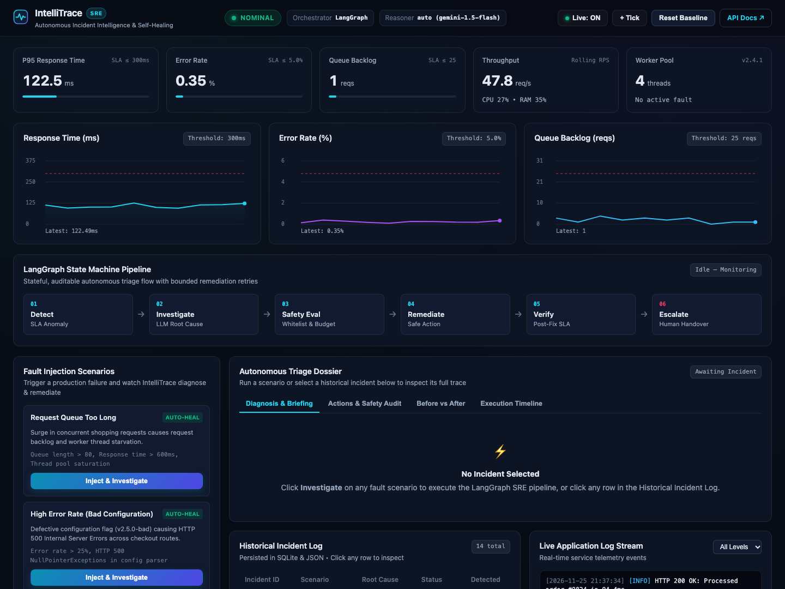
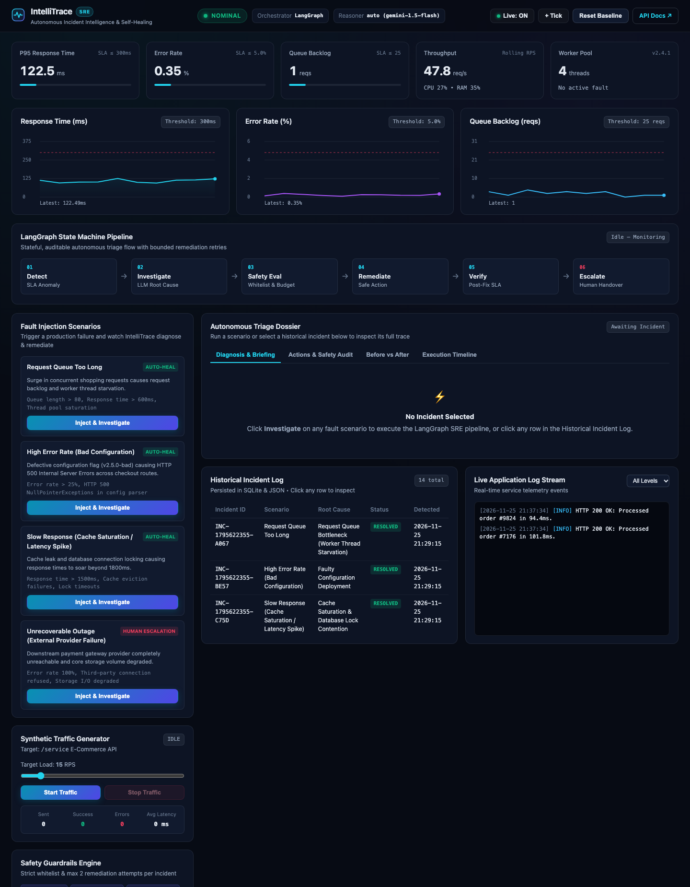
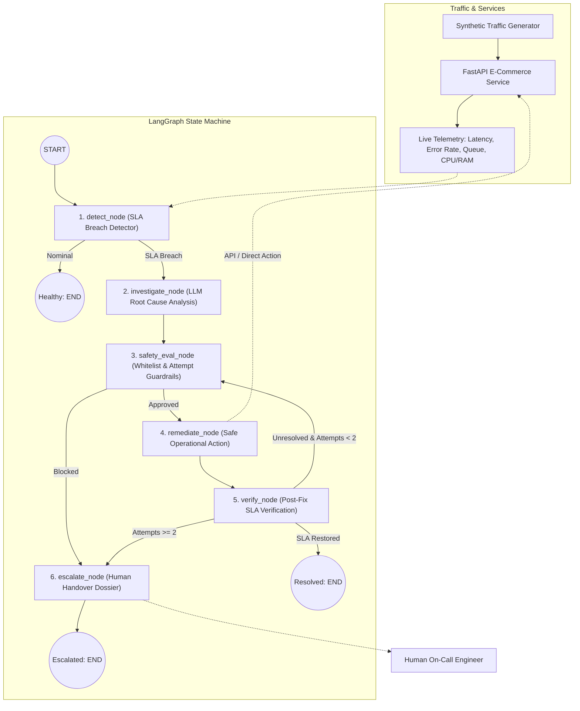

# IntelliTrace — Autonomous SRE & Incident Intelligence Platform

[]()
[](https://www.python.org/)
[](https://fastapi.tiangolo.com/)
[](https://langchain-ai.github.io/langgraph/)
[]()

**IntelliTrace** is an autonomous Site Reliability Engineering (SRE) and incident intelligence platform crafted by **Gajraj Jangid**. Built with **LangGraph StateGraph**, **FastAPI**, **LLM Telemetry Reasoning**, and a modern **HTML/CSS/JavaScript Web Console**, IntelliTrace continuously monitors application health, detects SLA breaches, performs evidence-backed root cause analysis, executes whitelisted safe remediations, verifies system recovery, and escalates unrecoverable outages to human engineers.

---

## Screenshots & Live Telemetry Graphs

### IntelliTrace Web Console (KPIs, Live SLA Charts & LangGraph Pipeline)


### Full SRE Workspace (Fault Scenarios, Triage Dossier & Historical Incident Log)


---

## Architecture



---

## Key Capabilities

### 1. Modern IntelliTrace Web Console (`src/web/`)
- Served directly by FastAPI at `http://127.0.0.1:8000/` (or `/dashboard`).
- Real-time KPI cards, HTML5 Canvas telemetry charts with SLA threshold overlays, interactive LangGraph pipeline tracker, one-click fault injection, synthetic traffic generator controls, safety policy validator, tabbed triage dossier, historical incident inspector, and live log stream.

### 2. LangGraph StateGraph Orchestration (`src/workflow/`)
- **`detect_node`**: Moving-average anomaly detection against SLA thresholds.
- **`investigate_node`**: Evidence extraction from telemetry and structured logs.
- **`safety_eval_node`**: Enforces action whitelist, parameter boundaries, and remediation budgets.
- **`remediate_node`**: Dispatches safe operational actions through `SafetyEngine` with full audit logging.
- **`verify_node`**: Evaluates stabilization telemetry to confirm SLA recovery.
- **`escalate_node`**: Synthesizes an executive SRE handover dossier when automated attempts are exhausted.

### 3. Multi-Provider LLM Telemetry Reasoning (`src/investigator/`)
- Supports OpenAI (`gpt-4o-mini`), Google Gemini (`gemini-1.5-flash`), or local Ollama instances via environment variables.
- Includes a deterministic offline heuristic reasoning engine for zero-cost, reliable execution without external API keys.

### 4. Strict SRE Safety Guardrails (`src/safety/`)
- **Action Whitelist**: `SCALE_WORKERS`, `ROLLBACK_CONFIG`, `CLEAR_CACHE`, `RESTART_SERVICE`, `DRAIN_QUEUE`, `ENABLE_RATE_LIMITING`.
- **Zero Arbitrary Execution**: Unapproved commands are blocked immediately and logged to `data/audit_trail.log`.
- **Remediation Budget**: Capped at **2 attempts** per incident to prevent cascading outages.

---

## Repeatable Failure Scenarios

| Scenario | Simulated Anomaly | Diagnosed Root Cause | Approved Safe Action | Result |
| :--- | :--- | :--- | :--- | :--- |
| **1. Request Queue Too Long** | Traffic surge exhausts worker concurrency | `Request Queue Bottleneck (Worker Starvation)` | `SCALE_WORKERS` | **RESOLVED** |
| **2. High Error Rate** | Bad config deployment (`v2.5.0-bad`) triggers 500s | `Faulty Configuration Deployment` | `ROLLBACK_CONFIG` | **RESOLVED** |
| **3. Slow Response Time** | Cache fragmentation & DB locks spike latency > 1800ms | `Cache Saturation & Database Lock Contention` | `CLEAR_CACHE` | **RESOLVED** |
| **4. Unfixable Outage** | External payment provider ECONNRESET + storage array crash | `Fatal External Infrastructure & Hardware Outage` | Attempts restart, halts at budget | **ESCALATED** |

---

## Quick Start

### macOS / Linux (`run.sh`)
```bash
chmod +x run.sh
./run.sh --api        # Start IntelliTrace Server + Web Console (http://127.0.0.1:8000)
./run.sh --all        # Run all 4 scenarios and display CLI scorecard
./run.sh --test       # Run pytest suite
./run.sh --dashboard  # Launch optional Streamlit dashboard
```

### Windows (`run.bat`)
```cmd
run.bat --api
run.bat --all
run.bat --test
```

### Direct Python CLI
```bash
python3 main.py --api
python3 main.py --all
python3 main.py --scenario queue
```

---

## Repository Structure

```
IntelliTrace/
├── config.py                     # Thresholds, ports, branding & safety bounds
├── main.py                       # Unified CLI and evaluation runner
├── requirements.txt              # Python dependencies
├── run.sh / run.bat              # Cross-platform startup scripts
├── .env.example                  # Environment configuration template
├── src/
│   ├── web/                      # Modern HTML/CSS/JS IntelliTrace Web Console
│   │   ├── index.html
│   │   ├── styles.css
│   │   └── app.js
│   ├── api/server.py             # FastAPI REST API + Web Console host
│   ├── real_app/                 # FastAPI E-Commerce service & traffic generator
│   ├── fake_app/                 # Simulated telemetry service & failure scenarios
│   ├── monitor/detector.py       # SLA breach & anomaly detector
│   ├── investigator/             # LLM & heuristic root cause engines
│   ├── safety/safety_engine.py   # Whitelist, budget & parameter guardrails
│   ├── storage/                  # SQLite + JSON incident persistence
│   ├── workflow/                 # LangGraph StateGraph & loop orchestrator
│   ├── dashboard/app.py          # Optional Streamlit dashboard
│   └── utils/logger.py           # Structured rotating logger
└── tests/                        # Unit & integration test suite
```

---

## Author

**Gajraj Jangid**
